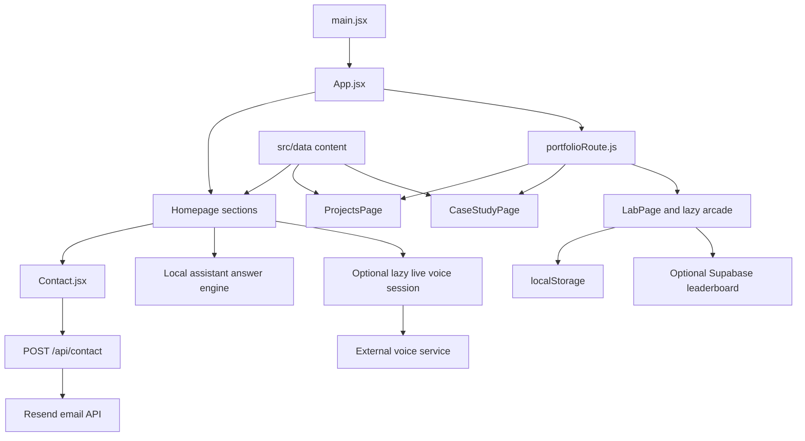

# CODEBASE.MD — portfoliobboy

Reviewed **November 26, 2026 (Asia/Manila)** against local `main` at `7eae94c` (`feat: add completed Claude Academy courses without badges`), including the requested crypto removal, local Alex workflows, and release improvements. This is a source-based project guide and code review, replacing the November 21 snapshot. Verification results below apply to this checkout; they do not establish the state of the deployed website or external service accounts.

## 1. Project overview

A personal developer portfolio built as a React single-page application, with dedicated project and arcade routes. It showcases professional experience, client case studies, independent products, credentials, recorded AI voice demonstrations, a local portfolio assistant, optional live voice conversations, a contact form, and nine browser games.

The configured production origin is `https://portfoliobboy.vercel.app`, defined in [src/data/routeMetadata.js](src/data/routeMetadata.js). The repository contains the frontend, one contact API function, optional Supabase SQL, build helpers, and automated tests. It does not contain the implementations of the client products described in the portfolio.

Current source inventory:

| Item | Count | Owning source |
| --- | ---: | --- |
| Featured project records | 18 | `src/data/portfolioData.js` |
| Dedicated case studies | 20 | `src/data/caseStudies.js` |
| Metadata/sitemap routes | 23 | `src/data/routeMetadata.js` |
| Independent products | 5 | `src/data/independentProducts.js` |
| Arcade games | 9 | `interactiveGames` in `src/data/portfolioData.js` |
| Credential records | 29 | `certifications` in `src/data/portfolioData.js` |
| Node test files | 21 | `tests/*.test.js` |
| Development browser spec files | 16 | `tests/e2e/` |
| Production-preview browser spec files | 6 | `tests/production/` |

These collections overlap; their counts are not intended to be added together. All project metadata routes now have matching case-study records.

## 2. Stack and prerequisites

| Layer | Implementation |
| --- | --- |
| Application | React 18, JavaScript/JSX, ES modules |
| Build tooling | Vite 8, `@vitejs/plugin-react`, Rolldown chunk configuration |
| Styling | Tailwind CSS 3, PostCSS, feature CSS, semantic theme variables |
| Icons | `lucide-react` |
| Graphics | Three.js, React Three Fiber, Canvas 2D, custom WebGL renderers |
| Audio | Native audio elements, Web Audio synthesizer, optional Howler assets |
| Live voice | `@elevenlabs/react` 1.19.0 and `@elevenlabs/client` 1.29.0 |
| Optional backend | Supabase JavaScript client for leaderboards; tutorial component also exists |
| Contact delivery | Vercel Node function using Resend's HTTP API |
| Tests | Node's built-in test runner, Python `unittest`, Playwright |
| Hosting configuration | Vercel static `dist/` output plus `api/contact.js` |

The Node engine requirement in [package.json](package.json) is `>=20.19.0 <21 || >=22.12.0`. Python 3 is needed for the resume tests/export helper; ffmpeg is needed only when regenerating waveform data. Playwright browser binaries are installed separately. Use `package-lock.json` for repeatable dependency versions: the reviewed install resolved Vite **8.3.5**, while `package.json` declares `^8.1.5`.

There is no TypeScript, ESLint, or standalone type-check script configured in `package.json`.

## 3. Directory map

```text
api/
  contact.js                   Contact form endpoint and abuse controls
index.html                     HTML shell, initial metadata, theme bootstrap reference
vite.config.js                 React plugin, resume asset plugin, chunks, preview rewrites
vercel.json                    Hosting routes, headers, CSP, function duration
src/
  main.jsx                     React entry, motion setup, service-worker registration
  App.jsx                      Page shell, routes, sections, palette, music, assistant
  index.css                    Shared styling and Tailwind layers
  components/
    Hero.jsx                   Introduction and featured-project carousel
    VoiceAgentDemo.jsx         Recorded demos and optional live voice panel
    ProductStudioPreview.jsx   Selected work, independent products, project archive
    ProjectsPage.jsx           Dedicated project explorer
    CaseStudyPage.jsx          Individual case-study UI and unavailable-state view
    LabPage.jsx                Explicit arcade launch page
    Contact.jsx                Enquiry form, booking intent, mail-client fallback
    assistant/                 Floating assistant, local workflows, evidence cards, brief review
    voice/                     Accent players, conversation gallery, voice visuals
    game/                      Lobby, dungeon, eight other games, shared controls
    *.css                      Feature styles and shared visual refinements
  data/                        Profile, products, case studies, voice scripts, game data
  lib/                         Navigation, metadata, storage, integrations, rendering helpers
  assets/audio/                Bundled accent, conversation, and welcome recordings
public/                        Theme script, service worker, offline page, images, fonts
scripts/                       Route metadata build, resume export, waveforms, QA helpers
supabase/
  schema.sql                   Consolidated leaderboard, local-only saves, tutorials schema
  migrations/                  Ordered historical schema changes and saves lockdown
  config.toml                  Supabase project configuration
tests/                        Node/Python tests, e2e/ and production/ browser specs
docs/                         Design system, audits, implementation notes, historical plans
ABEJO_CHARLIE_JAMES_RESUME.pdf   Canonical resume copied to a stable public URL
```

`node_modules/`, `dist/`, and browser test output are generated and ignored by Git. Root-level certificate scans, PDFs, and legacy text notes are source/reference material; they should not be confused with generated caches.

## 4. Runtime architecture



### Entry and homepage

[src/main.jsx](src/main.jsx) imports the CSS, enables entrance animations only when browser capabilities, motion preference, and visibility allow them, and mounts `App` in React Strict Mode. It also registers the service worker in production.

The homepage section order is defined directly in [src/App.jsx](src/App.jsx): Hero → Voice Studio → Services → Product Studio → About → Experience → AI Systems → Automations → Skills → Education → Lab preview → Contact. Shared navigation, footer, command palette, update banner, assistant, back-to-top control, and optional music surround the page content.

`ProductStudioPreview` composes the selected client work, independent products, and expandable project archive. The primary project browser also has its own `/projects` route. Several older components remain in the repository, so component existence alone does not prove that a feature is mounted.

### Routing and SEO

There is no router dependency. [src/lib/portfolioRoute.js](src/lib/portfolioRoute.js) maintains pathname/search/hash state, intercepts eligible same-origin links, updates browser history, and listens to `popstate` and `hashchange`. It preserves modified clicks, downloads, and external links. Supported browsers use View Transitions when reduced motion is not requested.

| Route | Behavior |
| --- | --- |
| `/` | Homepage |
| `/projects` | Project search and filters, with URL query state |
| `/projects/:slug` | Lazy case-study page; unavailable view for unknown slugs |
| `/lab` | Arcade overview and explicit game launch |
| `/charlie-james-abejo-resume.pdf` | Build-emitted copy of the canonical resume |
| `/api/contact` | Serverless POST/OPTIONS endpoint |

[src/lib/sectionNavigation.js](src/lib/sectionNavigation.js) reveals collapsed destinations before navigation. `App` also handles cold-load fragments and focus after lazy route content mounts.

[src/data/routeMetadata.js](src/data/routeMetadata.js) owns page titles, descriptions, canonical URLs, and project structured data. [src/lib/routeMetadata.js](src/lib/routeMetadata.js) applies metadata during client navigation. [scripts/prerender_routes.mjs](scripts/prerender_routes.mjs) writes route-specific HTML shells and a sitemap after Vite builds. These files contain metadata; React page bodies still render in the browser. This is not server-rendered React content.

### Data ownership and common edits

| Change | Start here |
| --- | --- |
| Identity, experience, skills, education, credentials, booking choices | `src/data/portfolioData.js` |
| Independent product copy and media | `src/data/independentProducts.js` |
| Three selected client studies | `src/data/selectedCaseStudies.js` |
| Dedicated case-study pages | `src/data/caseStudies.js` |
| Route titles, descriptions, canonical origin, sitemap inclusion | `src/data/routeMetadata.js` |
| Live product links and OneRide previews | `src/data/productPreviewData.js` |
| Automation examples | `src/data/automationsData.js` |
| Accent scripts and recordings | `src/data/voiceAccents.js`, `src/assets/audio/accents/` |
| Multilingual conversations | `src/data/voiceConversations.js`, `src/assets/audio/conversations/` |
| Waveform bars | `src/data/voicePeaks.json`, regenerated by `scripts/build-voice-peaks.mjs` |
| Dungeon narrative and gameplay configuration | `src/data/gameData.js` |
| Local assistant answers | `src/lib/assistantAnswers.js` |
| Project recommendations, role checks, brief prompts | `src/lib/assistantWorkflows.js` |
| Public resume | Replace the approved canonical root PDF; the build preserves its bytes |

Keep project descriptions, case-study records, route metadata, and evidence labels consistent. Displayed client-system architectures are portfolio content, not dependencies of this application.

## 5. Features and integrations

### Contact and booking

Alex has a shared call selector in text mode and the voice workspace. `PORTFOLIO_BOOKING_URL` optionally connects the 15-minute intro call to a public HTTPS appointment page. Vite validates this build setting before publishing it; malformed URLs, credentials and local hosts fail the build without printing the value. Other durations use their existing configured links or clearly labelled contact requests. Scheduling opens a separate tab without adding visitor notes or referrer information. Opening booking from voice stops any active or pending microphone session. Alex call requests keep an existing contact subject and message, with the prepared request offered separately for manual copying.

`BriefActions` is shared by the guided text brief and editable voice enquiry. Copy and UTF-8 text download preserve the current edited wording, including short nonempty and Unicode drafts. Save as PDF opens a local printable tab with a clear browser print-destination instruction; it is not an automatic binary PDF download. The print document escapes visitor text, uses selectable text and local fonts, and has no third-party rendering or persistence. Blocked clipboard, popup and download operations show an actionable fallback. Saving or copying a voice draft stops audio, including after a retry.

The Alex panel follows `visualViewport` resize and pan events so portrait, landscape and tablet keyboards do not cover the composer. Shared action groups wrap, mobile inputs remain 16px, controls have 44px touch targets, and compact layouts retain a sticky close control and composer.

[src/components/Contact.jsx](src/components/Contact.jsx) validates required fields, supports enquiry subjects and booking templates, prevents duplicate sends while pending, and posts JSON to `/api/contact` with a 20-second client timeout. Fields are locked while a send is pending so a successful response cannot discard newly typed edits. Failed sends preserve the draft and expose a mail-client fallback. Booking choices open a configured scheduling URL or prefill a request; a request does not itself reserve a calendar event.

[api/contact.js](api/contact.js) checks an exact origin allowlist, accepts JSON only, caps the body at 32 KiB, bounds individual fields, validates email, ignores honeypot submissions, escapes HTML, strips subject line breaks, and times out email-provider requests after six seconds. BotID Basic verifies hosted contact requests with a three-second deadline and fails closed; only explicit unhosted development bypasses verification. The 20-second function budget accommodates verification, email and optional analytics. The client bounds the complete submission to 25 seconds, preserves drafts after failures, and reuses an unchanged draft's UUID for content-bound Resend idempotency. The handler hashes the request address for an in-memory rate limit of five submissions per ten minutes, with at most 1,000 tracked addresses per function instance. This is a per-instance backstop, not a distributed rate limiter or authentication mechanism.

Delivery requires `RESEND_API_KEY`; sender and recipient are configured in the function. Vite dev/preview does not run this Vercel function and has no contact API proxy. Local frontend rendering alone cannot verify email delivery. Automated API tests mock provider calls; do not use real contact submissions as a routine QA step.

### Recorded and live voice

The recorded gallery includes eight accents and seven multilingual conversations. MP3s are imported from `src/assets/audio/` and emitted with hashed filenames. Playback uses static files rather than live generation. Waveforms are derived from recordings; scripts/transcripts are stored alongside the content data. The gallery identifies AI-generated voices and fictional conversations.

[src/components/LiveAgentPanel.jsx](src/components/LiveAgentPanel.jsx) enables live controls only when a nonempty `VITE_ELEVENLABS_AGENT_ID` is present. The session module is lazy-loaded, checks microphone permission, and provides connection, mute, end, retry, and elapsed-time controls. A cancellation gate prevents a delayed microphone grant from starting a connection after the visitor closes the session or requests a newer start. Voice audio explicitly uses the SDK's WebSocket transport; the agent's WebRTC path disconnected before its greeting during the 2026-11-26 investigation. Startup and disconnect errors offer a clear retry, including a server hangup before the first response. Its audio worklets are emitted as same-origin assets. Final visitor farewell transcripts immediately end the call; questions and negations mentioning goodbye keep it open. The panel shows a countdown, progress, and controls with explicit contrast in both themes. A monotonic timer and deadline end a connected session at 60 seconds, but enforceable usage and domain limits depend on external agent configuration. No signed-session API or server-side voice quota endpoint exists in this repository. A brief live WebSocket connection reached the agent greeting on 2026-11-26; provider usage limits and domain restrictions still require separate verification.

### Voice conversation workspace

[src/components/voice/VoiceConversation.jsx](src/components/voice/VoiceConversation.jsx) adds a labelled live transcript, starter questions, public case-study cards and editable enquiry fields to the existing voice session. [src/lib/voiceConversation.js](src/lib/voiceConversation.js) bounds the in-memory transcript to 80 messages of 2,000 characters, updates SDK IDs/corrections without duplicating starter echoes, and matches cards only against canonical portfolio data. Starter clicks send one explicit question through the active voice SDK; disconnected buttons cannot start detached calls.

Manual End, goodbye, the deadline and provider disconnect retain the workspace for review. Preparing a draft stops audio and uses only the visitor's statements, with scope, budget and timeline marked for discussion. Draft edits survive new turns and retries; replacement and contact handoff require explicit clicks. Opening a case study ends audio and opens a new tab. The existing staged contact path preserves an existing contact draft and never submits automatically. Closing voice, closing Alex, returning to the text guide or leaving the homepage discards this voice workspace. These messages are not persisted to browser storage or a new backend. Voice mode has its own scroll area in the Alex sheet; the local text assistant's state remains separate.

### Aggregate outcome analytics and voice fallback

The optional tracker in [src/lib/portfolioAnalytics.js](src/lib/portfolioAnalytics.js) emits eight fixed action types through [api/analytics.js](api/analytics.js), validated by [shared/portfolioAnalytics.js](shared/portfolioAnalytics.js). [server/portfolioAnalytics.js](server/portfolioAnalytics.js) forwards only allowlisted surface/starter/project/booking identifiers with a fresh random event ID, no person profiles or GeoIP, and no visitor IP, referrer, URL, transcript or form content. Browser requests omit credentials/referrers and respect Do Not Track and Global Privacy Control. Contact success is server-only after email-provider acceptance, not proof of inbox delivery; the public endpoint cannot spoof it. Capture failure is nonfatal and bounded to 1.5 seconds.

The owner selected a separate **Charlie Abejo Portfolio** workspace. Its personal project (769787) contains the private [Portfolio Enquiry Outcomes dashboard](https://us.posthog.com/project/769787/dashboard/2416983), with eleven saved native insights and eight proposed catalog count definitions. Production has the personal server-only ingestion configuration and browser enable flag; a rebuild applies collection. The Zalio organization/project was not changed. [docs/analytics/portfolio-dashboard.json](docs/analytics/portfolio-dashboard.json) records saved IDs and layouts. These are action totals, not unique visitors or attributed conversions; initial counts include setup verification. Setup and privacy limits are documented in [docs/analytics/README.md](docs/analytics/README.md).

Once connected, voice sends a bounded public evidence update built by [src/lib/voiceEvidence.js](src/lib/voiceEvidence.js). The deterministic answer audit corrects stale voice links, preserves dated role and private/planned project distinctions, and leaves price, delivery, availability and unproven experience unconfirmed. A contextual update reduces spoken-answer risk; it cannot guarantee provider behavior. [docs/alex-evidence-audit.md](docs/alex-evidence-audit.md) records cases and limits.

Microphone denial and provider failures expose Continue in text. This stops audio and keeps the transcript/draft in the same workspace, using local portfolio answers and existing project/enquiry tools. Try voice again requires an explicit click; it never restarts the microphone from a text question.

### Operational health monitoring

The private [Portfolio Health dashboard](docs/health/README.md) in the existing personal PostHog project shows observed availability, monitoring coverage, fixed error categories and accepted enquiries. `shared/healthTelemetry.js` keeps its event contracts separate from the eight product-action events. The public analytics endpoint accepts only client error categories; server-contact failures and synthetic uptime are privileged. Browser health reporting is bounded, respects DNT/GPC, excludes normal voice endings and never sends raw exceptions or private text. Contact reports are independently deduplicated per fixed category/minute/function instance.

`api/health.js` provides uncached configuration readiness without reading provider state or sending mail. The five-minute GitHub workflow checks only canonical safe routes and reports directly to PostHog independently of the portfolio host. Fixed owner-email alerts use a separate sending-only key, UTC-hour outage idempotency and hourly native PostHog error thresholds. Native configuration/limitations are recorded in `docs/health/`; no new public admin dashboard or query credential is exposed. The live security audit includes this route for 17 safe checks.

### Local portfolio assistant

The skills explorer groups 135 listed tools/practices into ten searchable categories, including dedicated AWS/cloud and DevOps/delivery panels. Group summaries, use cases and 22 public case-study links expose the evidence and project status. Offered-toolkit entries have structured `offeredSkills` metadata: Alex and role comparisons preserve their deployment caveat instead of treating a platform mention as delivered experience.

`automationsData.js` defines 24 service patterns across six categories and an 18-platform integration strip. `Automations.jsx` initially mounts six cards, supports combined search/category filters, progressive disclosure and keyboard focus after loading more. Each example includes trigger, steps, intended outcome, use case, implementation and safeguards. Enquiry links stage an editable subject and retain existing drafts; they do not create workflows or send messages. The catalogue count is separate from the owner's **70+ Custom builds** inventory, updated at the owner's explicit request on November 28, 2026. Public repository counts are a separate measure.

### Public GitHub contribution calendar

`GitHubActivity.jsx` and `githubCalendar.js` render the `/#github` year calendar from the same-origin `/api/github-activity?year=YYYY` read-only function. Navigation, search and Alex link to this section. GitHub requests begin near the viewport; the hero does not wait for the feed. The calendar supports current/previous UTC years, keyboard/touch day details, scoped phone scrolling, both themes, updated timestamps and retry/profile fallbacks.

`server/githubActivity.js` reads fixed anonymous GitHub public URLs, validates a full year's numeric/date contribution data and returns normalized fields only. It never forwards visitor cookies or GitHub credentials and never injects upstream HTML. This public endpoint explicitly sets all three cache headers for hourly CDN caching; failures are uncached. Other APIs retain private/no-store, CSP is unchanged and the service worker still excludes every API. Module caching coalesces requests and preserves timestamp/age on last-good fallbacks. Changes to GitHub's public HTML can make the calendar temporarily unavailable; GitHub controls public visibility and may take up to 24 hours to publish eligible activity. The screenshot's contribution total is not hard-coded. Local Vite dev/preview adapts only this exact public route to the production handler.

### Project shortlist, comparison and enquiry continuity

`/projects#project-shortlist` compares up to three existing case studies. Cards and case pages use `ShortlistButton`; `ProjectShortlist` shows the published role, responsibilities, stack, outcome and status, supports safe sharing and existing text/print exports, and stages an enquiry for review. Alex, command search and the featured-work section link here. The full panel, document tools and detailed case-study data stay lazy on the homepage; only the lightweight save control and allowlist are on its initial path.

`projectShortlistSelection.js` allowlists slugs from existing route metadata, caps and normalizes selection, and generates canonical share URLs containing only public slugs. `useProjectShortlist.js` retains those slugs in this tab's sessionStorage with an in-memory fallback, bounds stored JSON, synchronizes shared comparisons/history and preserves unrelated project filters. Private visitor input is never copied into the shared URL or shortlist storage. `projectShortlist.js` builds comparison/enquiry content from the case-study evidence, preserving private-source and in-development caveats. No new backend, provider, package or telemetry event is required.

`contactDraft.js` retains bounded unsent contact fields in page memory across internal route changes. Reloading clears this private draft; it is never written to browser storage, URLs or telemetry. Submission start clears its navigation copy so remounting cannot prefill an already-sending message. Version checks prevent stale failures from overwriting newer edits; an old successful request never clears a newer draft. Prepared shortlist enquiries use the existing manual-merge flow and preserve existing subject/message fields. Browser regressions cover both late success and failure after navigation.

### Completed Alex workflows and arcade recovery

Alex's text and voice recommendations reuse the same `ShortlistButton` and public selection store. `shortlistProjectLink.js` allows controls only for exact published case-study routes. Saving a project keeps the current call active; following **View shortlist** closes the mobile panel and ends voice before navigation. Voice evidence also ends audio on middle-click, while right-click leaves the call running. Text and voice enquiry reviews preserve existing subject and message fields through the prepared-draft/manual-merge flow.

**New chat** in the Alex header clears panel messages, per-mode text, brief answers/review and used suggestions, cancels pending local replies, unmounts voice and returns focus to a fresh text conversation. It does not clear the independent contact draft or public shortlist. Cleared chat contents are never sent to telemetry or stored in browser storage. The existing one-minute browser voice limit is unchanged.

`leaderboardData.js` validates and bounds local score data, ranks Pixel Racer by the lowest completed lap time and other games by descending points, retains scores per game and formats lap milliseconds as readable times. `supabase.js` bounds remote scoreboard reads/submissions to eight seconds and falls back to local/session scores on malformed JSON, denied/quota-limited storage, remote errors or timeouts. Leaderboards recover to an empty usable state instead of spinning indefinitely and show visitor-facing local-score copy. No database, schema, credential or provider change is involved.

`PortfolioAssistant` opens a lazy `AssistantPanel`. [src/lib/assistantAnswers.js](src/lib/assistantAnswers.js) matches questions against local portfolio and voice data, with contact-oriented fallbacks. Text answers do not call an LLM API. Three guided modes in the existing panel add project recommendations, recruiter comparisons, and brief preparation through [src/lib/assistantWorkflows.js](src/lib/assistantWorkflows.js):

- **Find projects** ranks case-study evidence by matching topics, technologies, and project names; each result shows Charlie's contribution, status, and a real case-study link. Unmatched requests receive an honest fallback.
- **Check role fit** accepts multiline requirements, up to 4,000 characters and 30 compared clauses. Whole-term matching keeps similar technology names separate. Results distinguish documented mentions, partly documented requirements, and requirements needing confirmation. Planned-only stack entries remain unverified; years, proficiency, certifications, and other qualifiers are not inferred from a skill mention. This local comparison is not a hiring verdict.
- **Prepare a brief** asks four questions (idea, users/problem, required features/integrations, timing/budget), retains the visitor's wording, and exposes an editable review limited to 4,500 characters before contact handoff.

The role comparison offers a locally generated recruiter summary with exact displayed requirements, statuses, uncertainty, evidence and the résumé link. Shared document actions provide copy, UTF-8 text download and native Save as PDF. No job text is sent or persisted. Unicode qualifiers remain unresolved rather than being certified as documented skills; reaching the native 4,000-character input cap displays and exports a coverage notice. Recruiter-summary exports are not tracked.

OneRide has a manually controlled walkthrough of three official Google Play screenshots, explicit contribution bullets and dated public evidence. The orders screenshot is labelled as an empty state. Public service names are aligned with the listing: Pasundo ride booking, Pasugo delivery and Pasabay ride sharing. No private screens, video or business outcomes are invented.

Brief download requests, PDF print views and configured booking-link activations have distinct anonymous count events. None confirms a saved file or appointment. Native right-click menu openings and failed exports are excluded; primary, keyboard and middle activations are counted. The same strict allowlist and privacy flags apply.

Mode inputs, conversation, brief progress, and edited briefs stay in React state throughout the current visit, including closing and reopening the panel. Hidden panels do not handle Escape or move focus, and any live voice session is unmounted on close. On short landscape screens, the sheet scrolls while close/send controls remain accessible. [src/lib/contactIntent.js](src/lib/contactIntent.js) stages an assistant enquiry in memory until the contact section mounts, including navigation from nested routes. It does not persist visitor text or submit requests. Existing contact messages are kept; a separate prepared-enquiry field supports manual merging. The visitor must still complete and submit the existing contact form.

The optional voice action uses the separate live-agent path above. The greeting remembers a prior visit locally and does not automatically open the microphone.

### Arcade, storage, and Supabase

The nine games are Dungeon Crawler, Space Shooter, Code Racer, Block Blast, Racing, Flappy Dev, Snake, Whack-a-Bug, and Neon Circuit. The lobby and individual games use dynamic imports. Local saves, player preferences, avatar choices, and best scores use browser storage.

[src/lib/supabase.js](src/lib/supabase.js) validates optional public configuration before creating a client. Leaderboard reads/writes fall back to localStorage, and a network-level failure disables repeat remote attempts for the session. SQL permits public leaderboard reads/inserts, so scores are client-supplied and unsuitable as verified competitive results. [src/lib/gameStorage.js](src/lib/gameStorage.js) handles dungeon preferences and saves with storage-error guards.

`Tutorials.jsx` can read published Supabase tutorial records but is not mounted by the current `App`. Cloud saves are not active: `saveGameCloud()` has no callers, and the consolidated schema plus the latest migration revoke client access to `game_saves`. Apply migrations in order; the initial historical migration predates the saves lockdown. No database migration was applied during this review.

[src/components/game/AudioManager.jsx](src/components/game/AudioManager.jsx) primarily uses [src/lib/synthAudio.js](src/lib/synthAudio.js). Its `AVAILABLE_AUDIO` set is empty, so excluded placeholder files under `public/audio/` are not requested. The previous document's claim that this necessarily causes production 404s or silence was incorrect.

### Themes, performance, and offline behavior

- `server/requestSecurity.js` shares exact origin validation across contact and analytics; hosted deployments reject loopback origins. `scripts/audit_site_security.mjs` verifies live headers, cache policies and origin preflights without submitting visitor data.
- Stable fonts/media refresh rather than using immutable browser caches. Private responses are excluded from offline caches. `SECURITY.md` records traffic/provider limits, and `.github/workflows/security.yml` plus Dependabot maintain repeatable security/dependency checks.
- `components/motion.css` supplies staggered hero entrances, layered client-study reveals, directional featured-project transitions and optional desktop scroll-timeline image depth. The primary headline remains readable during its entrance. Project switching remains manual.
- Phone/coarse-pointer reveals finish within 360ms without stagger. Reduced-motion changes expose pending evidence immediately, and a visitor's interaction cancels delayed cold-fragment position corrections.
- Selected project previews use optimized WebP copies with the original PNG assets retained. Recorded audio loads on Play, and touch screens keep the lightweight voice visual. The [mobile quality report](docs/quality/mobile-2026-11-27.md) records byte measurements, accessibility fixes and verification limits.
- `main.jsx` responds to reduced-motion changes during a visit. `sectionNavigation.js` exposes focused/linked content immediately; section links use native smooth scrolling while cold links and browser history settle immediately. Focus alone does not open a disclosure.
- `public/theme-init.js` applies a saved/system theme before React paints; `ThemeToggle` persists visitor choices and reacts to system changes.
- Heavy route pages, games, music, live voice, and optional graphics use dynamic imports. `prefetch.js` warms selected features on intent. The build names React, Three.js, and React Three Fiber vendor groups separately.
- Reduced-motion styles, focus handling, semantic controls, a skip link, and menu/dialog behavior are implemented; these are not a complete accessibility certification.
- The production service worker registers after window load. It uses network-first navigation/resume retrieval, cache-first bundled assets/fonts, and background refresh for stable media. APIs, cross-origin requests, and non-GET requests bypass caching. Updates wait for visitor acceptance through `UpdateBanner`.
- `vercel.json` configures CSP, HSTS, MIME sniffing protection, framing restrictions, microphone permission for the site's own origin, immutable asset caching, HTML revalidation, and no-store API responses. Local preview does not automatically apply Vercel headers.

## 6. Local setup and commands

```bash
npm ci --ignore-scripts
npm run dev
```

Dependency lifecycle scripts were disabled for the review install. The current project has no install/prepare hooks. Run commands from the repository root.

| Command | Purpose |
| --- | --- |
| `npm run dev` | Vite development server, default port 5173 |
| `npm test` | All Node tests, then Python resume tests |
| `npm run build` | Build to `dist/`, copy the resume, generate route metadata/sitemap |
| `npm run preview` | Serve the built site, default port 4173 |
| `npx playwright install chromium` | Install Chromium required by browser checks |
| `npx playwright test --project=chromium` | All development browser specs, server on 127.0.0.1:5175 |
| `npm run test:e2e -- --project=chromium` | All development browser specs using the configured browsers |
| `npm run test:production` | Rebuild, then run Chromium specs against local production preview |
| `node scripts/build-voice-peaks.mjs` | Regenerate waveform data; requires ffmpeg |
| `python3 scripts/generate_resume.py` | Copy the approved resume to the default export path |
| `npm run deploy` | Deploy through a remote Vercel production build using configured environment values; changes the live site |

The development Playwright configuration declares Chromium, Firefox, and WebKit. Install the other browser engines before running all projects. Production browser checks target local preview, despite the script's name. Deployment is listed for reference and was not run in this review.

### Environment configuration

| Variable | Location | Needed for |
| --- | --- | --- |
| `VITE_SUPABASE_URL` | Client build | Optional remote leaderboard/tutorial integration |
| `VITE_SUPABASE_ANON_KEY` | Client build | Public Supabase client key; relies on correct RLS |
| `VITE_ELEVENLABS_AGENT_ID` | Client build | Optional public live-agent controls |
| `RESEND_API_KEY` | Server runtime | Contact email delivery |
| `VERCEL_URL`, `VERCEL_BRANCH_URL`, `VERCEL` | Hosting runtime | Deployment origin checks and trusted address handling |

Use `.env.local` for local values. `.env*` is ignored except `.env.example`, which documents the optional voice/Supabase configuration and server-only email key. `VITE_` variables are public build inputs; server secrets belong outside that prefix. The portfolio frontend can render without optional integrations.

## 7. Review findings

### Resolved — removed the unused crypto project

The Web3 & Crypto project entry, its public demo link, and the unused Web3 category were removed at the owner's request. Since project metadata is derived from the featured project collection, the removed entry no longer generates a static project document or sitemap URL. The current inventory contains 18 featured projects, 20 case studies, and 23 metadata routes. Direct client navigation to an unknown project now receives the existing noindex fallback metadata.

### Resolved — release usability and tooling

- Closing Alex preserves local drafts and edited briefs for the visit; hidden panels release focus, Escape handling, and live voice sessions.
- Greeting booking actions navigate correctly from project routes.
- Short-height layouts retain access to Close and Send.
- Shared qualifiers such as “5 years of React and Python” remain attached to the full requirement.
- Contact inputs are protected during a pending submission.
- A late microphone permission grant cannot start voice after session closure.
- Rolldown uses the supported `codeSplitting` option while retaining separate vendor groups.
- `test:e2e` runs the complete browser suite. Credential and multilingual assertions track the actual published content.
- Setup documentation reflects all supported environment names, twenty case studies, current greeting behavior, and the existing microphone policy.

### Low — unused cloud-save helper conflicts with the database access model

`saveGameCloud()` still attempts a client insert into `game_saves`, but it is unused and the current schema/migration revoke client access. Keep local saves as the documented behavior. Before enabling cloud saves, introduce authenticated ownership and matching policies; do not restore broad public access to make this helper work.

### Operational limits to retain

Contact throttling is instance-local, leaderboard scores are untrusted browser submissions, and the live voice timer is a client-side convenience. External enforcement and service configuration were not verified. These are limits of the present architecture, not evidence that a remote service is misconfigured.

## 8. Verification performed

November 27 stability update: 159 Node and 2 Python checks, 56 targeted security checks, 60 production-preview Chromium checks, 24 cross-engine performance/offline checks, and 51 cross-engine contact/layout/audio checks passed. The live voice deadline is now 60 seconds; provider account settings remain unchanged at the owner's request. Hosted empty-body probes exercised actual BotID challenge routing and rejection without sending mail. A subsequent normal-browser check passed on release `27097c8`: one labelled test enquiry reached provider acceptance (HTTP 200), the success message appeared and the fields cleared with no browser errors. Required-field validation also passed. Inbox placement was not checked. Node is pinned to 24.x to keep deployment aligned with local tests and CI. See [SECURITY.md](SECURITY.md) for scope and limitations. The table below records the earlier November 26 review.

Environment: Node **24.14.1**, npm **11.11.0**, Python 3; fresh dependencies installed from the lockfile.

| Check | Result on November 26, 2026 |
| --- | --- |
| `npm ci --ignore-scripts --no-audit --no-fund` | Passed; 149 packages installed |
| `npm test` | Passed: 123 JavaScript tests and 2 Python tests |
| `npm run build` | Passed; emitted metadata for 23 routes; deprecated chunk-option warning removed |
| `npm audit --omit=dev --json` | 0 reported production dependency vulnerabilities |
| Metadata vs. case-study inventory | All 20 project metadata routes have matching case studies |
| Production-preview Chromium suite | Passed: all 32 tests with analytics enabled in the mocked harness, including explicit event/privacy checks, microphone-denied and provider-failure text fallback, transcript/draft retention, public evidence, review-only contact transfer, cleanup, deadline and retry |
| Complete development Chromium suite | Passed: all 137 development browser tests |
| Focused assistant suite | Passed: 13 each in Chromium, Firefox, and WebKit (39 checks total) |
| Crypto removal check | Passed: project/category removed; metadata and sitemap exclude the route; old built page absent; all 20 project metadata routes match case studies |

The Node run also logged an HMR WebSocket port collision (`24678`) between Vite test servers; all tests completed successfully. Treat it as test-harness noise to address if it becomes disruptive.

The security regression tests check tracked editor execution files, disguised loader names, package scripts, hidden whitespace payloads, and ignore rules. Passing these targeted checks and an npm advisory audit does not establish a comprehensive malware/security audit. Earlier claims about historical commits and remote branches were not revalidated here.

The new workflow tests exercise CRM/mobile recommendations, named and unmatched projects, technology boundaries (including React versus React Native evidence), mixed/qualified recruiter requirements, planned-only evidence, and brief text preservation. Browser checks exercise recommendation cards, role evidence, edited brief transfer from a nested route, mode-draft retention on a 320px viewport, preservation of existing contact text, mobile case-study navigation, and the absence of provider requests or automatic email submission. The complete development Chromium suite is included in release validation. Firefox and WebKit coverage is focused on the assistant; physical-device acceptance is separate.

GitHub access and the existing Vercel project target were verified for release. Source verification and public deployment acceptance are separate checks. No real email delivery, microphone session, remote database inspection, or physical-device acceptance was performed. The local changes include the crypto removal, Alex workflows, release fixes, corresponding tests, and documentation; generated installation/build/test artifacts remain local.

## 9. Maintenance guidance

1. Keep editable content in `src/data/` and update related case studies/metadata together.
2. Preserve the boundary between the local text assistant, prerecorded audio, and billable live voice.
3. Retain lazy loading for games, music, optional graphics, and live sessions.
4. Keep authentic screenshots, concept media, private systems, and unverified outcomes labelled accurately.
5. Preserve environment/editor ignore rules and the existing security regression checks.
6. Run the unit suite and build after relevant changes; select browser checks for the affected interactions.
7. Verify deployed headers, service settings, and real-device behavior separately when release work is authorized.

For deeper context, see [README.md](README.md), [docs/DESIGN_SYSTEM.md](docs/DESIGN_SYSTEM.md), [docs/portfolio-upgrade-report.md](docs/portfolio-upgrade-report.md), and [docs/live-voice-agent-production.md](docs/live-voice-agent-production.md). Historical plans describe intent and prior work; current source and fresh checks take precedence when they disagree.
